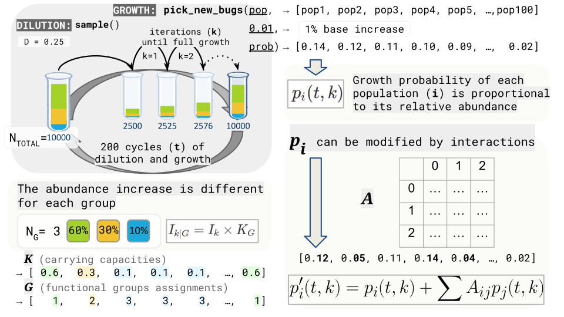

# dilgrowth: mechanistic simulations of dilution-growth experiments

This package includes command line scripts and standalone R/C++ functions for simulating growth-dilution experiments. The main script takes abundance data and simulates growth by randomly picking one or more species to grow in each iteration. When the desired total abundance is reached for the community, dilution happens by random sampling.



## Installation

To install `dilgrowth`, you can use the `devtools` package to install it directly from GitHub.Simply run the following commands in your R console:

```r
if (!require("devtools")) install.packages("devtools")
devtools::install_github("silvtal/dilgrowth")
```

After installation, you can load the package using `library(dilgrowth)`.

Note: The `dilgrowth` package uses C++ functions (via Rcpp) for computationally intensive operations, so you may need to have a C++ compiler installed on your system.

## Simulation Workflow

Each simulation starts from a user-provided abundance vector (i.e. one column of a community table). Optionally, functional-group metadata specifies carrying capacities that bound growth for each group. A single run cycles through:

1. **Dilution** – proportional resampling that shrinks the community by dilution factor `D`, where $N_{\text{total}}(t,0)$ is the total community abundance at the start of cycle $t$ (after dilution) and $N_{\text{total}}(t-1,\text{end})$ is the total community abundance at the end of the previous cycle (or at the start of the process):  

   $$ N_{total}(t,0) = {{N_{\text{total}}(t-1,end)}\over{D}} $$

2. **Growth** – repeated calls to compiled routines until the target total abundance (or group-specific capacities) is met.
3. **Fixation check** – determines whether any population exceeds the user-defined threshold for its group or for the whole community.

Parallel trajectories are typically launched via `mclapply()` so that each parameter combination can be explored independently:

```r
abund_temp <- mclapply(X = 1:no_of_simulations,
                       FUN = function(iter) {
                         simulate_timeseries(...)
                       }, mc.cores = cores)
```

Each call to `simulate_timeseries()` is a whole dilution-growth process with multiple cycles. Each iteration of the `while` loop inside `simulate_timeseries()` is a single cycle, and each call to the C++ growth functions corresponds to a single growth step within a cycle.

## Core Orchestrator: `simulate_timeseries()`

`simulate_timeseries()` manages the dilution–growth loop. Key arguments:
- `counts`: named vector with initial abundances (also sets population identifiers).
- `carrying_capacities`: optional named vector that groups populations and sets their niche sizes. When omitted, the community behaves as a single group.
- `interactions`: optional interaction matrix `A` that perturbs growth probabilities before sampling.
- `dilution`, `no_of_dil`, `abun_total`, `growth_step`, `is_growth_step_a_perc`, `logistic`: control cycle count, target size, growth magnitude, and whether logistic dynamics replace fixed-step growth.
- `keep_all_timesteps`, `allow_group_extinctions`, `force_continue`: error handling and output management.

The function iterates until all groups meet the fixation criterion or `no_of_dil` cycles elapse. Within each cycle:
1. The dilution sampler in R creates the new `this_timestep` by drawing `sum(this_timestep) * dilution` individuals with replacement.
2. Growth calls out to C++ helpers (`growth_one_group()`, `growth()`, or `growth_log()`) depending on whether groups and logistic behaviour are enabled.
3. `check_for_fixation()` inspects either the whole community or each group separately:
   - Without groups: `max(this_timestep)/sum(this_timestep) >= fixation_at`
   - With groups: compare per-group maxima to their totals.

## Growth dynamics and mathematics

For fixed-step growth, the helper `check_step()` adjusts the step size $I_k$ before each iteration:

$$I_k = \begin{cases}
 \text{trunc}(growth\_step \times N_{\text{total}}(k-1)) & \text{if percentage mode}\\
 \min(abun\_total - N_{\text{total}}(k-1),\; growth\_step) & \text{otherwise}
\end{cases}$$
ensuring at least one individual is added while never overshooting `abun_total`.

The sampling function `pick_new_bugs()` draws indices with probabilities proportional to the current abundances. When functional groups exist, the main `growth()` function normalizes probabilities within each group and caps each group’s total so that $K_G$ acts as its carrying capacity. Without groups, `growth_one_group()` performs the same sampling in a single pool.

If an interaction matrix is provided, probabilities are perturbed as:

$$p'(k) = p(k) + A \cdot p(k)$$

and any negative values are truncated to zero before renormalization. The conditional probability of population \(i\) inside group \(G\) becomes:

$$P_{i\mid G}(k) = \frac{p'_i(k)}{\sum_{j \in G} p'_j(k)}$$
so each group grows according to its internal composition while respecting its proportion of the total carrying capacity.

## Functions

- **`growth()`**: Each call executes one single iteration in the growth stage within a cycle. When functional groups are present, random selection occurs within each functional group, and all groups grow separately until reaching their respective carrying capacities. Probabilities are initialized as relative abundances, optionally modified by interactions, restricted to each group, and sampled via `pick_new_bugs()`. Each selected individual is incremented proportionally to the group’s carrying capacity $K_G$.
- **`growth_one_group()`**: Simulates growth when no functional groups are defined. Probabilities equal relative abundances, interactions are applied if provided, negative values are set to zero, and sampled indices are incremented in place for efficiency.
- **`growth_log()`**: Implements logistic growth dynamics, where growth rates change as populations approach their carrying capacities. For each group $G$ it samples individuals with `rbinom()`, computes the logistic step $2 \times (1 - \sum_G / K_G)$, and updates abundances accordingly. If a group exceeds its carrying capacity, populations in that group can decrease in abundance.
- **`pick_new_bugs()`**: Helper used by all growth functions to randomly select which populations will grow in each iteration using `RcppArmadillo::sample()`.
- **`check_for_fixation()`**: Without functional groups, fixation occurs when `max(this_timestep)/sum(this_timestep) >= fixation_at`. With functional groups, fixation is checked separately for each group by comparing per-group maxima and totals.
- **`roundVectorPreservingSum()`**: Rounds abundance values to integers while preserving the total sum. When `carrying_capacities` is provided, rounding is performed separately for each functional group so that group-specific sums are kept.

Whether there are groups or not, drift is simulated by sampling. More abundant species are more likely to be randomly picked and grow. However, if growth is set to be logistic, drift is simulated in each iteration with a binomial function applied to each species. That means that the number of individuals that will grow in each step is not limited.

## License

MIT LICENSE

## Dependencies
Rcpp, RcppArmadillo, data.table, gsubfn, magrittr, tidyr, untb, utils, stats

## Scripts
- `dilgrowth.R`: This script runs dilution-growth simulations in parallel for all functional groups specified in a file with information of each PCG (its leaves and final relative abundances, BacterialCore.py output). It also needs an abundance table from which a single column (sample) will be chosen as initial abudance data for the simulation. In each iteration of the growth simulations, growth of each bug will be logistic and depend on the carrying-capacity of its functional growth. This growth is also stochastic and simulates intra-group drift.

- `wrapper.sh`: Just a wrapper we use in our cluster. Does one single-PCG simulation separately for each PCG. Needs the `results.txt` PCG table + a `table.from.biom`-like abundance table. For each initial sample, a folder is generated that contains simulations _for each PCG separately_. Each PCG will reach the relative abundance that was specified on the PCG table.

## Tests
Multiple tests and their results available at /tests folder.

## Others

- tests/rcpptest.R : proof that c++ functions greatly accelerate simulate_timeseries' performance
